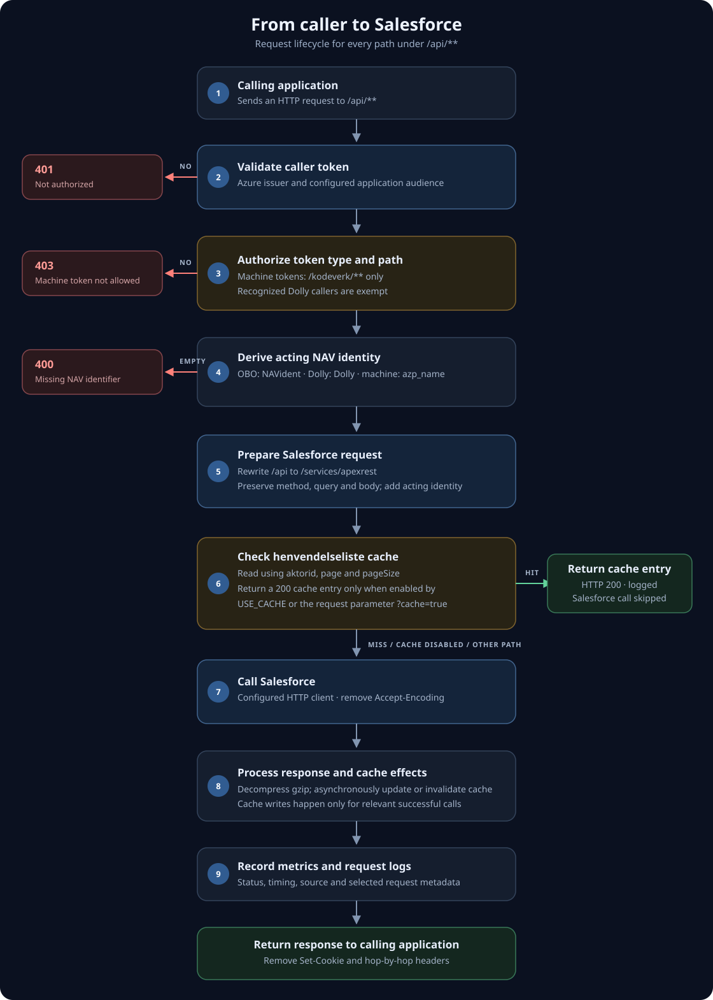

# sf henvendelse api proxy

Proxy for applications running in NAIS to access the Henvendelse API in Salesforce. Callers typically authenticate with an Azure on-behalf-of token. Machine tokens are permitted only for non-sensitive `kodeverk` endpoints, with a specific exception for Dolly callers.

Detailed /api request flow

### Decisions and side effects

- Token validation uses the Azure issuer configuration and the configured application audience. A missing or invalid token returns **401**.
- A token with the `access_as_application` role is treated as a machine token. Unless it is a recognized Dolly caller, it is allowed only when the request path contains `/kodeverk/`; other paths return **403**.
- The acting identity is taken from the `NAVident` claim for OBO tokens, set to `Dolly` for recognized Dolly callers, or taken from `azp_name` for other machine tokens. If no identity can be derived, the proxy returns **400**.
- For `henvendelseliste` paths, the proxy reads the cache before calling Salesforce, even when cached responses are not enabled. It returns a cached response only when the cache has status **200** and either `USE_CACHE=true` or the request has `?cache=true`; otherwise it continues to Salesforce. Successful Salesforce responses are written to the cache asynchronously.
- Successful selected write paths invalidate related cache entries asynchronously. Responses are logged and measured, gzip is decompressed when present, and `Set-Cookie` plus hop-by-hop response headers are removed before returning.

