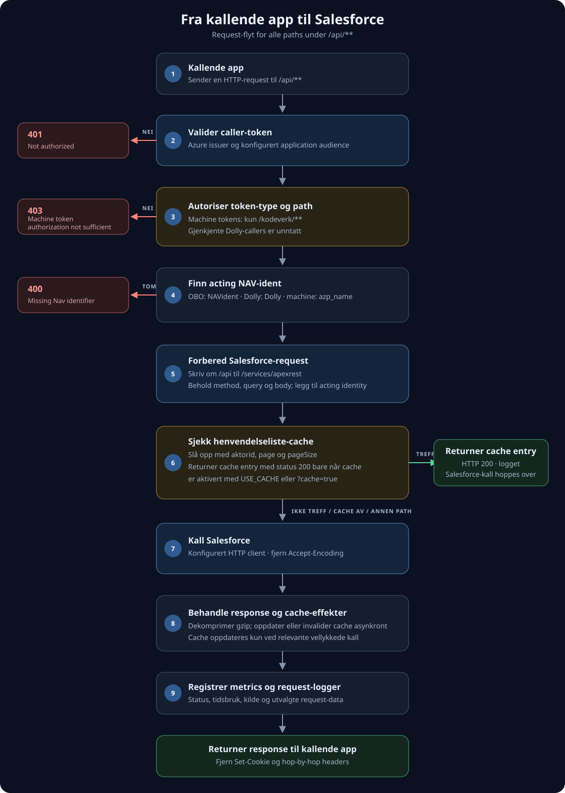

# sf henvendelse api proxy

Proxy for apper som kjører i NAIS og trenger tilgang til Henvendelse API i Salesforce. Kallende apper autentiserer seg vanligvis med et Azure on-behalf-of-token. Machine tokens er bare tillatt mot ikke-sensitive `kodeverk`-endepunkter, med et eget unntak for Dolly-callers.

Detaljert request-flyt for /api

### Beslutninger og sideeffekter

- Token validation bruker Azure issuer-konfigurasjonen og konfigurert application audience. Manglende eller ugyldig token gir **401**.
- Et token med rollen `access_as_application` regnes som et machine token. Med unntak av gjenkjente Dolly-callers er det bare tillatt når request path inneholder `/kodeverk/`; andre paths gir **403**.
- Acting identity hentes fra `NAVident`-claimet for OBO-tokens, settes til `Dolly` for gjenkjente Dolly-callers eller hentes fra `azp_name` for andre machine tokens. Hvis ingen identity kan utledes, returnerer proxyen **400**.
- For paths som inneholder `henvendelseliste` leser proxyen fra cache før den eventuelt kaller Salesforce, også når cache-respons ikke er aktivert. En cache entry returneres bare når status er **200** og enten `USE_CACHE=true` eller requesten har `?cache=true`; ellers går kallet videre til Salesforce. Vellykkede Salesforce-responser skrives asynkront til cache.
- Utvalgte vellykkede write-paths invaliderer relaterte cache entries asynkront. Responser logges og måles, gzip dekomprimeres når det finnes, og `Set-Cookie` samt hop-by-hop headers fjernes før responsen returneres.

